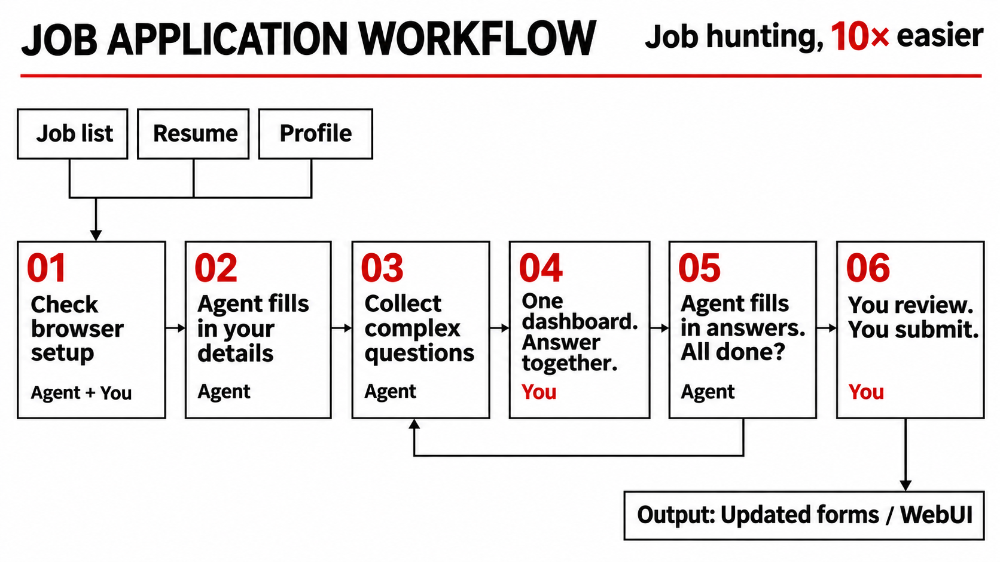

# Job Application Workflow

[English](README.en.md) | 简体中文

## TL;DR

> [!IMPORTANT]
> **“用 $job-application-workflow skill，按照工作流帮我申请这10个岗位”**

**只需要把你的 Resume 和 Profile 发给Agent**，agent 就可以全自动帮你投简历！从现在起，你再也不用从乱七八糟的网页中翻找position link，再也不用反复填写漫长重复的表单。

用了这个skill，你再也不用告诉每一个公司你学校在哪，叫什么名字，什么时间可以实习，可不可以在美国合法工作，是不是退伍军人......

### By this skill alone, make your career life 10 times easier!



### Reminder

这个skill会涉及到 Computer Use / Browser Use 的使用，我只在 GPT 上测试过，GPT用着很舒服。我使用的是 Edge 浏览器，**需要安装 ChatGPT 插件**。

建议使用： ChatGPT / Claude / 其他具备 Computer Use 能力的Agent

## 道理我都懂，求启动教程

跟你的 Agent 说：

```
请帮我安装这个 skill：
https://github.com/LaneTang/job-application-workflow

安装后检查 SKILL.md 及资源是否完整，并告诉我如何调用。
本次只安装，不执行求职申请。
```

## Something You  Want Know
## Profile 是啥

一个简单的 .md 文档，放你的 基本信息，学历，可实习起止时间，authorization，性别，身份认同，住址，是否接受onsite 等等等等

一个参考，这是我的 Profile.md 的结构：

```
# Job profile

## basic info
### education
### connect link
### diversity questions / Self-Identification Survey
### veteran / military / public servicer related

## immigration and internship positioning

## Job Experience

## work preferences

## compensation

## agreement

## application workflow
```

## 我建议你

建议你：把 Resume 和 Profile 放到本地的文件夹里，给 agent 开权限让它能够访问到，或者说放到 Agent 有权限的局部文件夹中。

建议你：想好你想给 AI 提供什么样的信息，先自己写一个大概的 profile.md，然后试着用本 Skill 投两个岗位作为测试，在投的过程中看着调整。
## 这是我的 Skill Idea

Skill 输入：对口岗位清单

我想让codex通过computer use 自动化的帮我：
1. 先检查投递环境和已知 profile 信息，是否需要额外的信息或者操作动作来登陆或者之类的，通知我来搞定，确认搞定之后，继续
2. 根据我提供的 profile 全自动化填写 标化申请信息 （学历，可实习起止时间，authorization，简历attach，位置，是否接受onsite 等等等等）；
3. 检查，记录高自主度申请问题（Cover Letter，为什么选择这家公司，通过实习你想学习到什么技能，你最喜欢的CPP特性是什么（？）等等）；
4. 整理进一个标准化的表格（交互界面可以使用webUI），反给我看。定义一个对象为一个正在填写信息的独立的求职岗位，定义对象属性包含的基础信息：公司，公司链接，岗位，申请链接，尚未填写的问题数量，（然后展开所有）尚未填写的问题，ready to go？（bool）。
5. （提供交互方式让我回答问题，当回答完问题之后）继续使用computer use 填写完剩余的问题，标记ready to go？为1，然后通知我
6. 填写完成后停在最终预览页，展示使用的简历、已填答案、待确认事项和 ready to go 状态，通知我复核。最终投递由我点击。

Skill 输出：申请表单/webUI 的 update

### 提交原则

Codex SHOULD NOT 越过我直接 apply。每个岗位都需要我复核最终预览。
- “申请这个岗位”“继续”“加上这个”“同时申请 5 个”等指令授权推进准备和填表。点击 Submit、Submit application、Send application 或其他实际发送申请的最终按钮，需要我在复核后针对具体岗位明确授权，否则由我亲自点击。
- ready to go = true 表示材料与表单已准备好，等待我复核和提交。已提交状态必须依据实际成功页面或其他明确凭据记录。
- 默认同意申请隐私声明的偏好仅适用于隐私声明，最终提交仍遵守上述逐岗复核规则。
